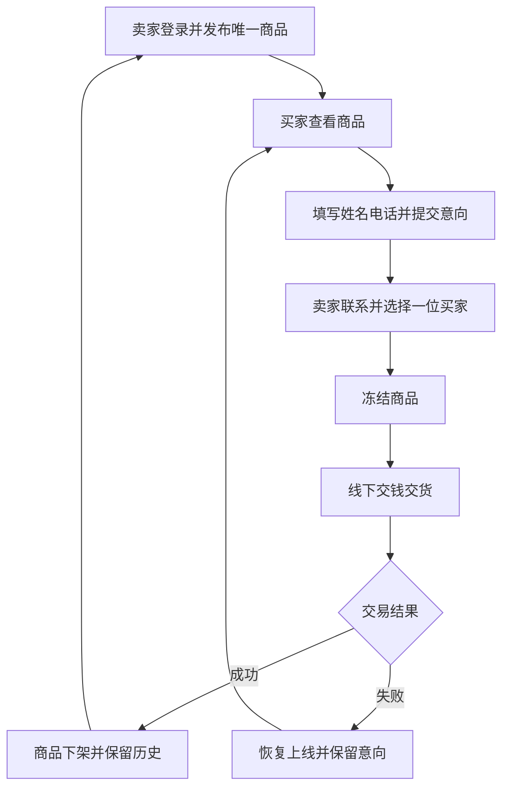

# 需求规格说明书

版本：0.1.0。范围：在线购物系统的基线需求。组号、成员姓名和最终分工待小组确认。

## 角色

游客买家无需账号，可浏览唯一商品，在想购买时填写姓名、联系电话、备注。系统只有一位卖家，需要登录后台。

## 功能与用例

| 编号 | 角色 | 需求 / 操作 | 前置条件 | 成功结果 / 异常 |
|---|---|---|---|---|
| F01 | 买家 | 查看商品名称、描述、图片、价格 | 无 | 返回在售或冻结商品；无商品时空状态 |
| F02 | 买家 | 填写信息并提交购买意向 | 商品在售 | 保存意向；冻结、下架、重复电话或非法信息时拒绝 |
| F03 | 卖家 | 登录、退出 | 固定卖家账号 | 有效期 8 小时的会话；非法凭据拒绝 |
| F04 | 卖家 | 发布商品 | 已登录且没有在售/冻结商品 | 保存唯一在售商品；非法价格、图片拒绝 |
| F05 | 卖家 | 查看历史商品 | 已登录 | 展示在售、冻结、已售及成交时间 |
| F06 | 卖家 | 查看意向买家 | 已登录 | 查询姓名、电话、备注和状态；游客无权查看 |
| F07 | 卖家 | 选择买家并冻结商品 | 在售且该买家意向有效 | 商品冻结，停止接收新意向 |
| F08 | 卖家 | 线下交易成功并确认 | 已冻结 | 商品下架；选中意向成交，其余关闭；允许发布下一件 |
| F09 | 卖家 | 线下交易失败并确认 | 已冻结 | 商品恢复上线；选中意向恢复待联系 |
| F10 | 卖家 | 修改密码 | 已登录且原密码正确 | 更新密码哈希，所有已有会话失效 |

## 业务流程

## 约束与数据

提交意向不自动冻结；卖家选择买家后才冻结。active/frozen 商品合计最多一件，sold 不占名额。商品与意向通过编号关联。同一商品的同一规范化电话不能重复提交。冻结、意向状态和过程日志更新具有事务原子性。

价格以整数分存储；图片 PNG/JPEG/WebP 不超过 2 MB；密码不明文保存。买家信息不出现在公开商品 API。SQL 使用参数化查询。默认只监听本机，课程演示采用 HTTP，未提供公网级运维和防护。

## 本版本不包含

注册、多卖家、购物车、在线支付、配送、评价、库存扩展等升级功能。
