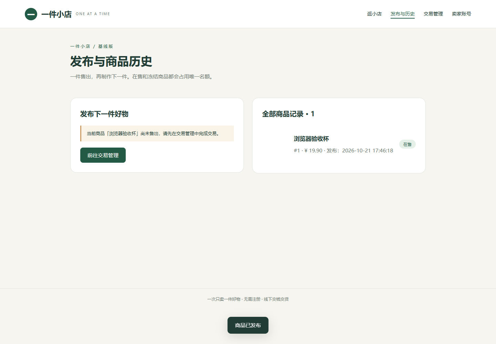
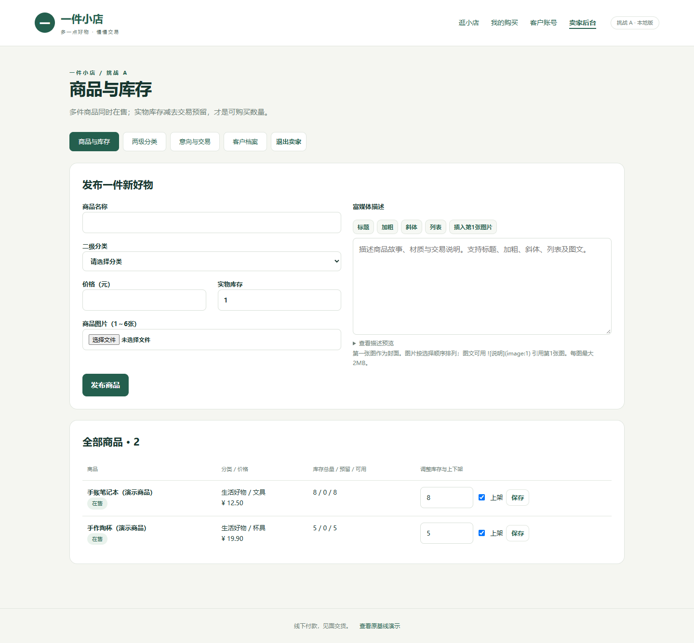

# 庄云月：Java系统测试与跨层验收

负责人：庄云月 / Ricee1129。维护backend-java/src/test/java/cn/course/shopping/、本目录和测试执行脚本。

原test_acceptance.py/run_tests.py及历史results已归档legacy/python-stage1/06_系统测试/。当前测试是Java JUnit，不调用Python服务；历史通过/失败记录不作为Java结论。

## 执行

在根目录双击本目录“运行Java测试.bat”，或：

```powershell
powershell -NoProfile -ExecutionPolicy Bypass -File scripts/test.ps1
powershell -NoProfile -ExecutionPolicy Bypass -File scripts/smoke-jar.ps1
```

跨平台可运行mvn clean verify。第一条通过随机端口真实HTTP、隔离临时SQLite执行JUnit，生成results-java的XML/JSON/报告/源码指纹；第二条运行实际打包JAR、重启并核对数据和修改后密码的持久化。

SystemAcceptanceTest覆盖F01～F10、权限、输入、请求防护、并发、状态一致性与静态资源限制；PasswordCompatibilityTest用标准及独立实现向量验证旧密码格式和Unicode。

结果只代表当前本机源码及执行环境。自动测试不代替成员课堂演示；浏览器验收记录、未执行的Docker/CI边界见docs/java-migration/迁移说明.md。

##一、开场白
本次我负责 online-shopping-mvp 电商 MVP 项目的系统测试与跨接口验收工作，下面从测试准备、环境部署、测试执行、接口链路验收、结果说明依次汇报。
##二、测试准备
获取项目源码：从 GitHub 仓库下载源码 ZIP 包，解压到无中文路径；


环境识别：本机默认 JDK8，项目 SpringBoot3 要求 JDK17，因此额外安装 Eclipse Temurin JDK17，和 Java8 共存，不修改系统默认 Java；
工具准备：IDEA（后端启动、JUnit 单元测试）、浏览器（前端页面黑盒测试）、Apifox（接口调试）；
测试范围：后端服务、前端静态页面、核心业务接口链路（登录→浏览商品→加购→下单→查询订单）；
测试依据：需求文档、接口文档、预先编写的系统测试用例、跨接口验收流程。


##三、 测试环境搭建过程
配置：在 IDEA 中单独给 backend-java 项目指定 SDK 为 JDK17，避免版本冲突；
启动后端：IDEA 加载 Maven 依赖，启动 SpringBoot 后端服务，后端基于 SQLite 内嵌数据库，无需额外安装数据库；
启动前端：进入静态前端目录，使用 Python 简易静态服务，前端地址 127.0.0.1:8081，解决直接打开 html 跨域问题；
连通验证：后端启动成功后，先调用登录接口，确认前后端网络连通。

##四、系统功能测试（黑盒测试）
在浏览器前端页面，按测试用例逐项手动执行：
用户模块：用户登录、信息查看
商品模块：商品列表浏览、商品详情查看
购物车模块：添加商品、修改数量、删除购物车商品
订单模块：提交结算、查看订单列表
记录每一项的实际结果，对比预期结果，记录缺陷。
✅ 截图：前端页面操作截图（商品页、购物车、订单页）
##五、跨接口验收（这是你报告重点，链路测试，不是单个接口）
重点区分：单接口测试是单独测一个接口；跨接口验收是连续业务链路，上一个接口返回结果作为下一个接口入参
测试链路：
用户登录接口 → 获取商品列表接口 → 添加购物车接口 → 创建订单接口 → 查询订单接口
执行步骤：
调用登录接口，拿到 token；
携带 token 请求商品列表；
选中商品，携带 token、商品 id 调用加购接口；
携带购物车信息提交订单；
调用查询订单接口，校验订单状态、商品信息是否和下单一致。


##六、 单元测试（可选加分项）
在 IDEA 执行后端 JUnit 单元测试套件，运行后端各个 service 层单元用例，验证底层逻辑正确性；查看测试执行结果，统计通过 / 失败用例数。
✅ 截图：JUnit 全部绿色通过的测试窗口
##七、测试结果、缺陷说明（如实写）
示例话术，你可以按需改：
本次共执行 XX 条系统功能用例，XX 条跨接口链路用例；
大部分核心电商流程可正常跑通，登录、加购、下单主链路验收通过；
发现问题（有 bug 就写，没有就写：本次测试暂未发现阻塞性严重 bug，少量优化点）：
例：前端提示文字不够友好 / 异常场景（重复下单）没有提示；
风险说明：当前为 MVP 版本，只覆盖核心业务，未做高并发、边界压力测试。
##八. 总结 & 收尾
本次完成了本地环境搭建、系统功能测试、核心业务跨接口链路验收，验证了前后端交互、接口数据传递正确性，测试证据（控制台截图、页面截图、接口返回截图）已整理，存入项目06_系统测试目录，可用于评审归档。

## 与开发成员协作

接口冻结前补充正常/异常场景；接口变更后更新测试；缺陷记录须包含请求、预期、实际响应和复现步骤。本人实际运行、Codex辅助运行与CI自动执行应分别记录，不把辅助操作记为成员本人执行。


[当前Java源码](https://github.com/LittleChenLiya/online-shopping-mvp/tree/main/backend-java) · [完整启动说明](https://github.com/LittleChenLiya/online-shopping-mvp#启动) · [迁移与验证记录](https://github.com/LittleChenLiya/online-shopping-mvp/tree/main/docs/java-migration)。第一阶段Python说明保留在仓库legacy/python-stage1及Wiki历史中。


## 第2次评审：完成与复核记录

责任成员：庄云月。组长确认本轮六位成员已分别完成或复核对应模块，沿用现有六人分工。Java迁移及自动执行由Codex辅助；个人完成/复核归属不等同于独立手工编写全部代码或本人亲自运行全部测试。

- [当前对应源码](https://github.com/LittleChenLiya/online-shopping-mvp/tree/main/backend-java/src/test/java/cn/course/shopping)
- [固定Java实现提交](https://github.com/LittleChenLiya/online-shopping-mvp/commit/f5d9a72312b3e9ca889680474607cda1096d8e58)
- [可下载源码ZIP](https://github.com/LittleChenLiya/online-shopping-mvp/archive/f5d9a72312b3e9ca889680474607cda1096d8e58.zip)
- [Windows/Ubuntu/Docker验证通过](https://github.com/LittleChenLiya/online-shopping-mvp/actions/runs/39582524968)
- 本轮任务见[[第2次阶段性评审报告]]；教师意见评审后记录。

## 测试用例、执行方式与模型辅助过程

本节补充日期：2026-10-29。测试负责人为庄云月，负责维护用例、复核结果、整理缺陷与回归证据。已入库记录中的本机自动执行者为 Codex，不能改写为庄云月本人逐条手工执行。本次完善成果说明没有重新运行以下测试。

### 一、测试是如何完成的

1. **从需求拆用例。** 依据 F01～F10 与挑战 A 规则，为每项功能列出正常、非法输入、权限、状态冲突和并发场景，先写预期结果，再执行。
2. **隔离测试环境。** JUnit 启动真实 Spring Boot HTTP 服务，使用随机端口和临时 SQLite；每个测试重置测试数据。浏览器测试使用独立数据库及隔离买家/卖家会话，避免污染正式商品和密码。
3. **准备数据并发请求。** 创建卖家会话、图片、商品和两个买家意向，通过真实 HTTP 调用接口。并发测试同时发送多个请求，检查成功数量、失败响应及最终数据库状态。
4. **断言业务结果。** 同时核对 HTTP 状态码、JSON 字段、商品/意向/事件状态及拒绝操作后的数据，防止只看到“200”就判定全部正确。
5. **检查打包与界面。** 启动实际 JAR、停止后重启核对数据保留；浏览器实际点击、上传、取消/确认、切页及检查窄屏。
6. **记录与复测。** 保存 JUnit XML、结果 JSON、源码指纹、服务日志和截图。缺陷记录受测版本、请求、预期与实际结果、修复提交及复测结论。

### 二、基线 Java 的 20 项自动化用例

下表均有已入库通过记录，原始结果见 [results-java](https://github.com/LittleChenLiya/online-shopping-mvp/tree/main/06_系统测试/results-java)。这是项目级测试，不能理解为庄云月独立手工编写或执行的 20 项操作。

| 编号 | 对应测试方法 | 操作与预期结果 |
|---|---|---|
| J01 | fullWorkflowAndHistory | 从空商品到发布、意向、冻结、失败恢复、再次冻结、成交；核对首页下架、历史保留、允许发布下一件 |
| J02 | validationAndDuplicateIntent | 非法金额、图片、名称及重复电话意向被拒绝；正常信息可保存 |
| J03 | authenticationPasswordAndLogout | 未登录拒绝后台操作，错误密码登录失败；改密后旧会话失效，新密码可登录，退出后不能复用会话 |
| J04 | expiredAndForgedSessions | 使用过期、伪造会话调用后台；拒绝访问 |
| J05 | requestGuards | 检查安全请求头、来源和 Content-Type；不合约定的请求被拒绝 |
| J06 | malformedJsonAndBodyLimit | 非法 JSON、非对象 JSON、请求体大小边界；返回相应错误而不执行业务 |
| J07 | concurrentPublish | 并发发布两件商品；只能一件成功，未售商品总数不超过 1 |
| J08 | concurrentDuplicateIntent | 并发提交相同商品和电话的意向；不能写入重复记录 |
| J09 | concurrentFreezeSelectsOneBuyer | 并发选择不同意向冻结同一商品；最终只能选中一个交易对象 |
| J10 | conflictingTradeResultsAreConsistent | 并发提交成交与失败等冲突操作；最终商品、意向、事件保持一致 |
| J11 | rejectedOperationDoesNotChangeState | 对非法状态/意向执行交易操作；拒绝后原有数据不被部分修改 |
| J12 | staticFilesAndPrivatePaths | 访问允许的静态资源及私有路径；正常资源可用，私有路径不能泄露 |
| J13 | limitsDoNotCreateProduct | 超长名称、描述、非法金额、图片等边界输入；不产生商品残留记录 |
| J14 | specialCharactersSavedAsData | 输入引号等特殊字符；按数据保存，不改变数据库查询含义 |
| J15 | reinitializeKeepsDataAndChangedPassword | 重复初始化数据库；商品及修改后的密码保留 |
| J16 | rejectsWrongJsonFieldTypesAndCountsUnicodeCharacters | 用布尔值/字符串/浮点数冒充编号等字段，及中文/emoji边界；类型检查和码点计数正确 |
| J17 | verifiesPbkdf2Sha256KnownVector | 用已知向量检查 PBKDF2-SHA256 密码兼容 |
| J18 | verifiesUnicodePasswordFromIndependentImplementation | 用独立实现产生的 Unicode 密码向量验证编码兼容 |
| J19 | randomSaltAndMalformedHashes | 检查随机盐与错误哈希输入处理 |
| J20 | continuesFrozenTradeFromActualPythonDatabaseWithoutResettingPassword | 加载旧 Python 样本数据库；不重置密码，可继续处理原冻结交易 |

J01～J16 位于 SystemAcceptanceTest，J17～J19 位于 PasswordCompatibilityTest，J20 位于 LegacyDatabaseCompatibilityTest。一个测试方法可能含多次请求与多个断言，不以请求数冒充测试方法数。

### 三、浏览器与运行包检查

已有 12 项基线 Edge 检查通过：空首页、登录及图片预览发布、游客提交意向、取消冻结不改状态、冻结后禁止购买、失败恢复、成交后历史及再次发布、改密重新登录、快速切页、退出、390px 窄屏、无未捕获页面异常。

另有 6 项实际 JAR 启动/重启检查，结果在 [jar-smoke.json](https://github.com/LittleChenLiya/online-shopping-mvp/blob/main/06_系统测试/results-java/jar-smoke.json)，用于复核打包服务及持久化。不要将 20、12、6 相加写成同一种自动化单元测试数量。



以上为基线验收截图；[浏览器报告及完整记录](https://github.com/LittleChenLiya/online-shopping-mvp/blob/main/docs/java-migration/浏览器验收.md)保留执行方式和版本。

### 四、挑战 A 专项用例

挑战 A 已基本完成，以下用例用于专项验收。当前公开记录只有既有基线回归通过及页面展示，未见这些专项用例逐项结果，因此状态如实标为“待登记专项结果”。

| 编号 | 前置条件与操作 | 预期结果 | 状态 |
|---|---|---|---|
| A01 多商品/搜索 | 发布两件不同名称商品；搜索关键词、分页、进入详情 | 两件可同时在售，搜索匹配准确，分页/详情一致 | 待登记专项结果 |
| A02 两级分类 | 建一级和二级，尝试建三级、同级重名；删除含商品/子类的分类 | 二级合法，三级/重名拒绝，关联删除拒绝；父类筛选含子类商品 | 待登记专项结果 |
| A03 图片与描述 | 上传1～6图和格式文本；尝试第7张、超2MB、伪造图片及脚本文本 | 有效图文展示正确，非法图片拒绝，文本不执行脚本 | 待登记专项结果 |
| A04 库存预留 | 库存5，提交数量2的意向，再开始交易 | 提交后可用5，开始后总5/预留2/可用3；调整总库存到1拒绝 | 待登记专项结果 |
| A05 库存并发 | 库存5，多笔订单并发开始交易，合计需求超过5 | 成功预留不超5，无负库存；失败请求不留下部分更新 | 待登记专项结果 |
| A06 成交/释放 | 交易失败、客户取消，再成交到库存0；重复处理已结束订单 | 失败/取消释放预留，成功扣总库存，零库存下架；重复处理拒绝 | 待登记专项结果 |
| A07 客户账号 | 注册、重复用户名、登录、错误原密码改密、正确改密、退出 | 必填/重复/身份校验正确，密码及会话按规则更新 | 待登记专项结果 |
| A08 权限隔离 | 客户甲尝试查询/取消乙订单，游客调用客户/卖家受保护接口 | 拒绝越权，不泄露乙记录，不改变乙订单 | 待登记专项结果 |
| A09 历史快照 | 下单后改资料/价格；查看客户历史和卖家客户统计 | 原订单联系方式、地点、价格快照保留；统计只计实际成交 | 待登记专项结果 |
| A10 重启与页面 | 建分类、商品、客户、订单及预留后重启；检查图文、切页、窄屏 | 数据、预留和权限正确，页面无影响操作的遮挡或溢出 | 待登记专项结果 |



此图为 2026-10-29 独立演示数据库的挑战 A 实际页面，可说明库存检查位置；截图本身不能证明 A05 并发或 A08 权限用例通过。

### 五、如何复现测试

前置环境：JDK 17+、Maven；首次构建需要联网。浏览器检查额外需要 Node 22+、Playwright 与 Edge/Chromium。使用仓库对应版本，在根目录执行：

```powershell
# Java 构建与自动测试，生成结果报告
powershell -NoProfile -ExecutionPolicy Bypass -File scripts/test.ps1

# 实际 JAR 启动与重启检查
powershell -NoProfile -ExecutionPolicy Bypass -File scripts/smoke-jar.ps1

# 基线浏览器检查（先完成构建）
npm ci
npm run test:browser
```

跨平台 Java 构建测试可用 `mvn clean verify`。非 Windows 的浏览器检查需按 README 安装 Chromium。JUnit 原始 XML 在 `backend-java/target/surefire-reports/`，记录脚本整理到 `06_系统测试/results-java/`；浏览器结果在 `docs/java-migration/browser-results/`。

这些现有命令执行基线测试，不能自动把上述 A01～A10 变为通过；挑战 A 专项需要按用例实际执行或新增对应自动测试后保存结果。

### 六、如何借助大语言模型完成测试

下面是测试协作方式的归纳。提示词是整理示例，不是历史聊天逐字记录，也不据此声称所有用例由负责人本人手工执行。

| 环节 | 向模型提供的内容 | 模型辅助工作 | 测试负责人复核重点 |
|---|---|---|---|
| 需求分析 | 需求规格、接口契约、业务状态和负责范围 | 拆分正常/异常/权限/并发场景，建立需求到用例映射 | 预期来自需求，不照抄当前代码行为 |
| 测试实现 | 当前 Java 工程、路由、字段与环境要求 | 编写 JUnit 真实 HTTP 测试及隔离数据库准备/清理 | 服务和数据库是否真实使用，是否误连正式数据 |
| 运行取证 | 明确运行命令、受测版本及输出位置 | 实际执行构建、测试、JAR和浏览器脚本，保存原始结果 | 区分“生成代码”与“执行通过”，核对失败数与日志 |
| 发现问题 | 失败日志、请求输入、预期和实际响应 | 分析复现路径，给出测试或实现修正建议 | 判断是需求缺陷、产品缺陷还是测试脚本问题，交给对应开发负责人 |
| 复测归档 | 修复提交、原失败用例及相关回归范围 | 重跑相关验证、整理报告与截图 | 记录实际执行人和日期，保留首次失败与复测证据 |

**设计用例的提示词示例：**

> 根据 F01～F10 和接口契约整理测试。每个用例写前置条件、输入、步骤、预期响应、数据状态、对应需求。覆盖错误输入、游客权限、重复操作和并发。测试用独立临时 SQLite，通过随机端口访问真实 Java HTTP 服务。先列预期依据，不把现有代码行为自动当作正确需求。

**挑战 A 追问示例：**

> 总库存5，有两笔数量3的订单，同时开始交易。设计一个并发测试，确认预留合计不能超过5；失败请求不能留下事件或状态的部分修改。请保存请求响应和最终库存，不要用顺序调用声称验证了并发。未实际运行标注待验证。

**结果整理提示词示例：**

> 依据本次真实 XML、JSON 和服务日志生成测试报告，写明版本、环境、实际执行者、通过/失败/跳过数量和缺陷。将基线与挑战 A 分开统计，不编造通过结果或教师签名。

### 七、缺陷与执行记录模板

| 用例编号 / 需求 | 受测提交号 | 输入与操作 | 预期 | 实际 | 结论 | 实际执行人/日期 | 原始证据 / 修复与复测 |
|---|---|---|---|---|---|---|---|
| 按实际测试填写 | 待填 | 待填 | 待填 | 待执行后填写 | 待验证 | 待填 | 日志/截图/缺陷链接 |

测试成果由“可重复执行的程序、需求对应的用例、实际结果、问题修复与复测记录”共同组成。成员本人运行或复核后，按实际情况补充本人记录。
