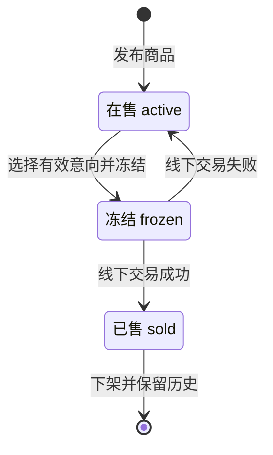

# 在线购物系统：基线需求 / 六人分工

本项目面向单一卖家，买家无需注册即可浏览商品并提交购买意向；卖家在线下交易前冻结商品，成功后下架，失败则恢复上线。系统同时只允许一件未售商品，付款与交货在线下完成，只实现课程基线需求。

项目由五个业务与基础设施模块及一个系统测试模块组成，采用 Python 标准库 HTTP 服务、SQLite 数据库和 HTML/CSS/JavaScript。运行不需要第三方 Python 包，建议使用 Python 3.10 或更新版本及 Edge/Chrome 浏览器。

## 汇报阅读顺序

[需求说明](#需求说明) · [六人分工](#六人分工) · [按顺序演示](#按顺序演示) · [接口约定](#接口约定) · [状态与数据关系](#状态与数据关系) · [验证](#验证)

## 需求说明

版本1.0，2026-10-15。下列内容融合Word需求文档，用于直接在线汇报。需求描述的是应达到的目标，实际验证结果见“验证”章节。

[下载 Word 需求规格说明书](https://github.com/LittleChenLiya/online-shopping-mvp/raw/refs/heads/main/%E5%9C%A8%E7%BA%BF%E8%B4%AD%E7%89%A9%E7%B3%BB%E7%BB%9F%E9%9C%80%E6%B1%82%E8%A7%84%E6%A0%BC%E8%AF%B4%E6%98%8E%E4%B9%A6.docx)

### 范围与用户角色

本版本不包含买家注册、购物车、在线支付、配送、多卖家、评价、营销或批量库存等升级需求。商品售出后可发布下一件，系统不自动执行实物制作。

| 角色 | 权限与职责 |
|---|---|
| 买家 | 无需账号；查看当前商品、填写姓名和电话并提交购买意向。不能查看其他买家信息或操作后台。 |
| 卖家 | 唯一固定账号；登录、退出、发布商品、查看历史与意向、冻结、处理线下交易结果、修改密码。 |

开发和测试成员属于项目分工，不是新增系统登录角色。

### 功能用例与验收条件

| 编号与功能 | 角色 | 前置条件 | 主要操作及验收结果 |
|---|---|---|---|
| F01 商品浏览 | 买家 | 无 | 查询唯一在售或冻结商品，展示名称、描述、图片、价格及状态。没有商品时显示空状态；已售商品不在公开首页显示。 |
| F02 购买意向 | 买家 | 商品active | 填写姓名、电话、可选备注，提交后返回意向编号。冻结、下架、无效输入或同商品同规范化电话重复时拒绝。提交不自动成交或冻结。 |
| F03 登录退出 | 卖家 | 固定账号 | 正确凭据建立会话，错误凭据拒绝。退出删除当前会话；未登录访问后台接口应返回401。系统不提供注册。 |
| F04 发布商品 | 卖家 | 已登录且无未售商品 | 填写完整商品信息并上传合规图片，保存为active。在售或冻结商品存在时，不允许发布第二件；并发请求也应保持唯一。 |
| F05 商品历史 | 卖家 | 已登录 | 按新到旧查询全部商品，展示当前状态、发布时间及已售成交时间。已售记录保留，不用删除记录实现下架。 |
| F06 意向查看 | 卖家 | 已登录 | 查看商品对应买家的姓名、电话、备注及意向状态。公开商品接口不返回买家隐私信息。 |
| F07 选择与冻结 | 卖家 | 商品active，意向pending | 选择属于该商品的有效意向，商品变frozen并保存交易对象，所选意向变selected。拒绝重复冻结和跨商品错选。 |
| F08 交易成功 | 卖家 | 商品frozen且已选买家 | 线下完成交易后确认成功，商品变sold并记录成交时间，所选意向completed，其余同商品意向closed；允许发布下一件。 |
| F09 交易失败 | 卖家 | 商品frozen且已选买家 | 确认失败后恢复active、清空所选编号，所选意向恢复pending；保留商品、意向与过程记录，便于继续交易。 |
| F10 修改密码 | 卖家 | 有效会话、原密码正确 | 校验新密码后保存带盐哈希，并使所有已有会话失效，要求重新登录。原密码错误、过短或与原密码相同的新密码拒绝。 |

### 关键业务规则

- 在售与冻结商品合计最多一件，已售商品不占名额；并发请求也必须满足这一约束。
- 购买意向不等于付款或成交，也不自动冻结；由卖家选择买家后冻结。
- 禁止在售直接成交、已售恢复上线和重复成交。
- 商品、意向状态与过程记录必须在同一写事务中更新，异常时整体回滚。
- 线下是否真实付款由卖家确认，系统不接入在线支付。

### 输入与数据校验

| 数据项 | 校验要求 |
|---|---|
| 商品名称与描述 | 名称1～80字，描述1～2000字，去除首尾空白后不能为空。 |
| 价格 | 以元为输入字符串，正数且最多两位小数，上限9999999.99元；用Decimal转换为整数分保存。 |
| 商品图片 | 必填PNG、JPEG或WebP，原始字节不超过2MB；校验Data URL、Base64与文件头。此校验不代表完整图片解码或安全扫描。 |
| 买家姓名与电话 | 姓名1～40字；电话原输入6～30字符，规范化去除空格、括号和横线后核对主体长度6～20。允许系统约定的电话号码字符，不进行短信真实性验证。 |
| 备注与编号 | 备注可空且最多300字；商品编号、意向编号必须是正整数，不接受布尔值代替编号。 |
| 密码与请求体 | 新密码8～128字符，不能与原密码相同；JSON请求体不超过3MB。超限应返回明确错误，不产生业务写入。 |

### 安全与运行要求

密码应采用随机盐与PBKDF2哈希；会话默认8小时，Cookie使用HttpOnly和SameSite。SQL使用参数绑定，页面显示用户文本时转义；私有数据库及源码不能通过静态URL下载。服务器仅默认监听本机，当前配置为课程HTTP演示，不承诺公网部署安全或未经测量的性能指标。

重启应保留正式数据与已修改密码。自动化测试应使用独立临时数据库与端口，不能污染正式商品和密码；保存测试版本指纹、真实日志和失败证据。浏览器操作与布局需另行验收。

## 六人分工

| 负责人 | GitHub 账号 | 文件夹 | 职责与主要文件 |
|---|---|---|---|
| 谢相逸 | LittleChenLiya | `01_前端界面` | 页面、表单、交互与 API 对接；index.html、style.css、app.js |
| 余昕越 | ygccbpkn12345 | `02_商品浏览与购买意向` | 当前商品查询、买家信息校验及意向提交；buyer.py |
| 王暾（组长） | wangtun773 | `03_商品发布与历史` | 商品发布、价格图片校验及商品历史；products.py |
| 黄扬轩 | aixuan1206 | `04_交易与冻结管理` | 意向查询、冻结、成交下架与失败恢复；trades.py |
| 曾大君 | Sisyphu-s | `05_卖家账号与系统集成` | 认证、数据库、HTTP 服务及原有回归测试；database.py、security.py、server.py、test_system.py |
| 庄云月 | Ricee1129 | `06_系统测试` | 新增跨模块验收测试、执行与复核、证据及问题记录；test_acceptance.py、run_tests.py |

项目组号为第十二组。仓库由谢相逸创建并持有，组长为王暾。根目录的 `start.py` 和 `启动系统.bat` 由系统集成模块维护。各成员文件夹中的 README 说明关键函数、变量及答辩问题。01～05通过 API 和共享数据库协作，06测试这些模块；各文件夹不是分别独立的完整系统。

## 启动

从GitHub下载当前源码后，在仓库根目录运行系统集成模块的入口：

```powershell
python "05_卖家账号与系统集成/server.py"
```

根目录也提供统一启动脚本，可使用下列方式：

双击 `启动系统.bat`，或在本目录的终端中运行：

```powershell
python start.py
```

保持终端打开，在浏览器访问 **http://127.0.0.1:8000**。按 Ctrl+C 停止。

首次卖家账号：`seller`；初始密码：`seller12345`。登录后在“卖家账号”修改密码。系统没有注册入口。已有数据库中的密码不会因重新启动而重置。

端口占用时使用 `python start.py --port 8001`，访问对应端口。首次启动前可用环境变量 `SHOP_INITIAL_PASSWORD` 指定初始密码；`SHOP_DB_PATH` 可指定数据库文件。默认数据库为根目录 `data/shop.db`，启动时自动创建，停止和重新启动不会清除数据。`data` 仅保存运行数据，系统测试任务单独位于 `06_系统测试`。

## 按顺序演示

1. 首次访问买家页面，显示“当前没有在售商品”。
2. 点击“发布与历史”，登录卖家账号，填写名称、描述、价格并上传图片，发布第一件商品。
3. 用浏览器隐私窗口打开首页，查看商品并提交姓名、电话、备注。无需登录或注册。
4. 卖家在“交易管理”查看购买意向，选择一位买家并冻结商品。
5. 买家刷新首页，看到“交易中”，不能提交新意向；卖家不能发布下一件商品。
6. 先演示“交易失败”，商品恢复上线；原购买意向仍保留，可重新联系和选择买家。
7. 再次冻结，在线下完成交钱交货后点击“交易成功”，商品下架，所选意向标记成交，其余意向结束。
8. 在“发布与历史”查看已售商品，并发布下一件。修改密码后，所有卖家登录会话失效。

提交意向本身不冻结商品；卖家确认交易对象后冻结。已售商品不会删除，以便查看历史。没有购物车、在线支付、多卖家、配送、注册或其他升级需求功能。

## 接口约定

所有接口返回 JSON；成功返回 HTTP 200；失败返回 `{"error":"原因"}`。前端金额以元输入字符串，数据库和响应金额为整数分。商品编号、意向编号必须是正整数。

POST 请求设置 `Content-Type: application/json` 和 `X-Requested-With: ShopApp`。卖家登录后浏览器自动携带 HttpOnly 会话 Cookie。

| 方法与路径 | 负责成员 | 参数或响应要点 | 卖家登录 |
|---|---|---|---|
| GET /api/product | 2 | `{product:对象或null}`，含 id/name/description/image/price_cents/status/created_at | 否 |
| POST /api/intents | 2 | product_id、buyer_name、contact、note；返回 id/message | 否 |
| POST /api/products | 3 | name、description、price（字符串）、image（图片 Data URL）；返回 id/message | 是 |
| GET /api/products | 3 | `{products:[商品]}`，包含在售、冻结、已售商品 | 是 |
| GET /api/trades | 4 | `{product:当前商品或null,intents:[意向],events:[过程记录]}` | 是 |
| POST /api/trade | 4 | product_id、action；freeze 另需 intent_id | 是 |
| GET /api/account | 5 | logged_in、username | 否 |
| POST /api/login | 5 | username、password；设置 Cookie | 否 |
| POST /api/logout | 5 | 空对象；删除当前会话 | 否 |
| POST /api/password | 5 | old_password、new_password；清除所有会话 | 是 |

常见错误码：400 参数错误、401 未登录或凭据错误、403 请求安全校验失败、404 不存在、409 业务状态冲突、413 请求过大、415 请求格式错误。

## 状态与数据关系



| 原状态 | 操作与前提 | 结果状态及关联处理 |
|---|---|---|
| 无未售商品 | 卖家发布 | active；可以接收购买意向 |
| active | 选择本商品有效意向并冻结 | frozen；保存selected_intent_id，所选意向selected |
| frozen | 线下成功 | sold；成交时间写入，所选意向completed，其余closed |
| frozen | 线下失败 | active；清空所选编号，所选意向pending |

| 对象 | 关键数据与关系 |
|---|---|
| seller | 固定单一卖家，保存账号与密码哈希；不保存明文密码。 |
| products | 名称、描述、图片、整数分价格、状态、创建/成交时间和所选意向编号。 |
| intents | 关联商品，保存买家姓名、电话、备注、状态及创建时间；同商品规范化电话唯一。 |
| trade_events | 关联商品与意向，记录freeze、success、failure及操作时间。 |
| sessions | 保存会话令牌哈希与过期时间；Cookie令牌与服务端有效会话对应。 |

同一商品可以有多个意向买家，但一次交易只选择一个。SQLite 写事务和唯一索引共同保证同时最多一个未售商品。冻结、修改意向状态、记录过程在同一事务中完成。

## 验证

`06_系统测试`包含可执行测试、用例、日志与复核记录。下载仓库后可执行全部14组；下列现场结论只对应记录中的本机版本，新环境需重新执行并查看真实结果。

在项目根目录执行完整自动测试，或双击 `06_系统测试/运行测试.bat`：

```powershell
python -X utf8 -B "06_系统测试/run_tests.py"
```

06模块复用第五模块6组回归测试，新增8组验收测试，共14组，涵盖完整交易、权限和改密码、唯一商品、并发意向与冻结、冲突交易结果、非法HTTP输入、字段/图片上限、私有路径及特殊字符保存。两部分来源明确区分，不重复计数。

测试会自动临时启动服务，不需要先启动演示系统；每个用例使用独立临时数据库与随机端口，结束自动关闭和清理。Windows有D盘时，06脚本默认使用 `D:/Codex/work/shopping-tests-06`，也可通过 `SHOP_TEST_TEMP_DIR` 配置临时目录。正式商品与密码不用于自动化测试。

结果保存在 `06_系统测试/results`：

- `测试报告.md`、`test-log.txt`、`test-results.json`：真实测试结论、输出和源文件指纹。
- `复核记录.md`：断言、执行方式和正式数据库前后哈希核对。
- `问题记录-T001.md`：已观察到的连接异常及复现情况。

**2026-10-15最新现场结果：14组中13组通过、1组错误；新增8组全部通过。** 原有 `test_request_guards` 在非法Content-Type请求上出现间歇性的 Windows WinError10053，预期415响应未正常读到，原因尚未定位。正式数据库前后SHA-256一致。不能沿用历史某次全部通过的结果，或宣称此异常已修复。

本次执行负责人为庄云月，现场由Codex辅助运行与复核。浏览器图片预览、确认框、快速切页、窄屏布局及真实运行录屏仍需另行验证；自动测试通过不等于界面或公网部署已经验收。

随后发布前对集成副本执行的14组测试全部通过，Python/JavaScript语法检查和构建也通过，见 `06_系统测试/results/发布前验证说明.md`。由于T-001曾间歇出现，保留前述现场失败证据，不以本次通过宣称异常已修复。

如需单独执行原有回归或前端语法检查：

```powershell
python -X utf8 -B "05_卖家账号与系统集成/test_system.py"
node --check "01_前端界面/app.js"
```

Node仅用于开发阶段的JavaScript语法检查，运行项目不需要Node。

这是本机课程演示项目，服务默认仅监听 127.0.0.1，使用 HTTP。商品和记录增多后，历史接口目前一次返回全部记录；分页、公网 HTTPS 部署、登录限流等不属于本次基线实现。用户手工在浏览器完成一次上述演示可以检查页面交互。

### 需求与测试追踪

| 需求或规则 | 验收用例与检查重点 |
|---|---|
| F01、F02 | 商品空状态/展示与意向保存；重复与冻结拒绝；A01并发重复、A08特殊字符。 |
| F03、F10 | 未登录拒绝、正确登录退出、原密码校验、改密码使所有旧会话失效。 |
| F04、F05 | 发布、金额图片约束、未售商品唯一、历史保留及持久化；A07超限不写入。 |
| F06、F07 | 后台意向查询、正确选择买家冻结；A02竞争冻结、A04无效操作不改变状态。 |
| F08、F09 | 成交与失败流程、禁止非法状态；A03冲突交易结果只生效一个且多表一致。 |
| 请求与文件边界 | A05非法JSON/声明长度；A06静态文件与私有路径；原有请求防护回归。 |
| 浏览器界面 | 表单提示、图片预览、取消确认、快速切页、窄屏布局及完整交易现场演示。 |

## GitHub 与课程材料

- [公开仓库](https://github.com/LittleChenLiya/online-shopping-mvp) · [固定 Wiki Home](https://github.com/LittleChenLiya/online-shopping-mvp/wiki) · [版本与源码下载](https://github.com/LittleChenLiya/online-shopping-mvp/releases)
- [历史汇报材料与系统演示](docs/presentation-2026-10-15/)：保留此前发布的PPT与演示视频，当前六人版PPT和需求Word见根目录。
- [第一次汇报.pptx](第一次汇报.pptx)：六人个人工作汇报，共13页，庄云月的测试部分包含最新结果和T-001问题。
- [在线购物系统需求规格说明书.docx](在线购物系统需求规格说明书.docx)：5页，包含角色与用例、业务规则、输入约束、数据接口和验收追踪。
- `06_系统测试`：测试代码、README、用例与手工清单、个人汇报提纲、日志和复核记录。
- 第五模块 `docs`、`wiki` 中保留早期准备材料；涉及当前人员、执行结果时，应核对最新报告和在线Wiki，不沿用旧占位或历史测试结论。
- 本机已提供构建脚本、Dockerfile和CI配置草稿，其存在不代表镜像构建或部署已验证；完整部署证据及真实测试录屏仍需补充。
- 项目采用AI辅助开发与文档整理；各成员应如实登记自己的修改、执行及复核工作，不代造个人提交或完成记录。
- 当前仓库同步了六个模块、启动与构建配置、六人版PPT、需求Word及实际测试记录。历史准备稿和早期视频保留作参考；当前状态以根目录文档、最新实际测试记录及在线Wiki为准。
