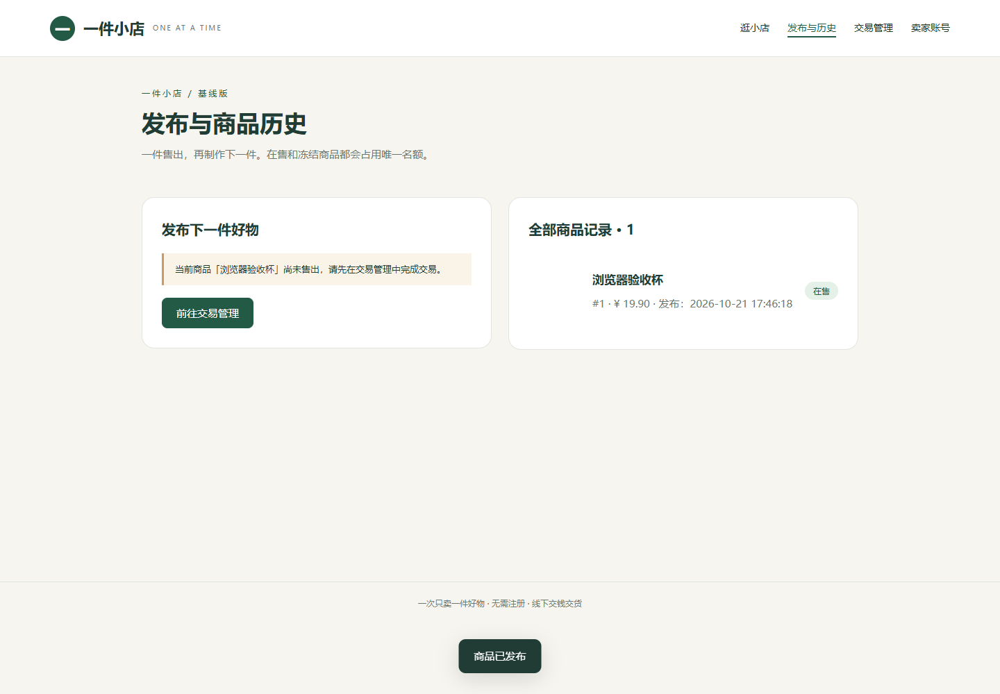
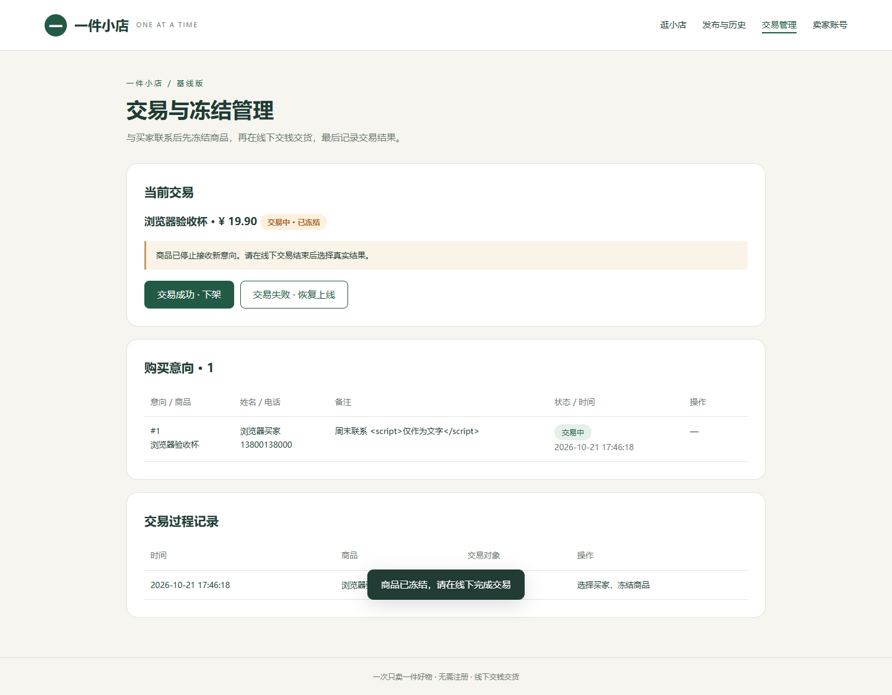
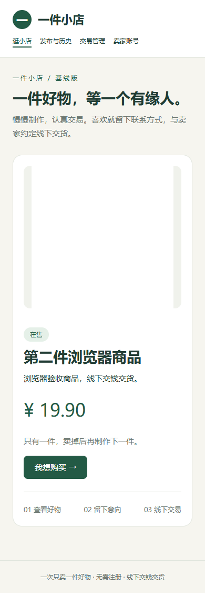

# Java版浏览器验收

执行方式：Codex使用Playwright控制本机Edge无头浏览器，启动实际Java JAR，使用随机端口、独立临时SQLite、隔离的买家/卖家浏览器上下文。未连接正式数据库。结果及浏览器版本以[browser-results/results.json](browser-results/results.json)为准。

本地12项检查通过，无未捕获页面异常：

1. 空首页展示。
2. 卖家登录、上传图片预览、发布商品。
3. 买家不登录提交意向。
4. 取消冻结确认后状态保持active。
5. 冻结后显示交易对象，买家旧页刷新不能提交。
6. 交易失败恢复active。
7. 成交后公开商品移除、历史保留、允许发布下一件。
8. 改密码后要求重新登录，新密码可用。
9. 快速切换页面最终显示最新路由。
10. 退出后返回登录页。
11. 390px窄屏商品页没有横向溢出。
12. 无未捕获页面错误。

截图来自合成测试商品（一像素PNG测试图，用于验证图片上传与解码，非正式商品素材）：

复现：先mvn clean verify构建JAR，再npm ci、npm run test:browser。Windows默认Edge，其他系统需npx playwright install chromium。SHOP_BROWSER_CHANNEL可覆盖浏览器channel。

自动浏览器验收不等于真实用户易用性研究、手机真机测试或课堂演示录屏。浏览器测试脚本是前端开发辅助JavaScript，后端及系统API测试为Java。
