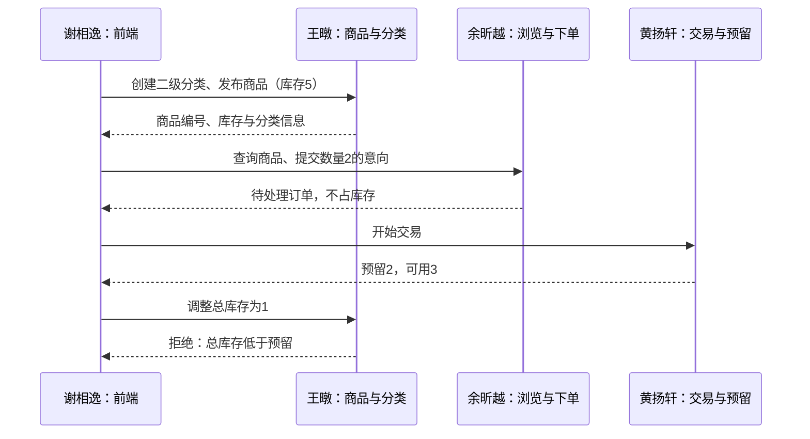

# 王暾：商品发布、分类与库存接口成果

负责人：王暾 / wangtun773，组长。当前负责基线商品发布与历史，以及挑战 A 的卖家商品管理、分类管理、多图描述校验和库存调整。挑战 A 已基本完成，后续继续完善联调、专项测试和交付证据。

## 1. 我的职责与代码位置

| 范围 | 代码 | 我的维护与复核内容 |
|---|---|---|
| 基线商品接口 | `backend-java/src/main/java/cn/course/shopping/product/ProductController.java`、`ProductService.java` | 发布商品、价格与图片校验、唯一未售商品规则、历史查询 |
| 挑战 A 卖家商品与分类接口 | `backend-java/src/main/java/cn/course/shopping/challenge/CatalogController.java`、`Catalog.java` | 多商品发布、卖家商品列表、库存与上下架调整、两级分类管理 |
| 组长协调 | 接口约定、第二次评审报告与成员分工 | 明确接口输入输出，协调前端、公开查询、订单库存与测试验收 |

这里的“接口”是 HTTP 方法和 URL 的组合。例如 GET 和 POST `/api/products` 是两个不同操作。8000、8001 是系统监听的网络端口，由统一服务提供，并非我个人负责的业务接口数量。基线默认地址为 `http://127.0.0.1:8000`，挑战 A 默认地址为 `http://127.0.0.1:8001/challenge-a`。

## 2. 基线：我负责的 2 个接口

| 方法与路径 | 用途与输入 | 返回与关键规则 |
|---|---|---|
| `POST /api/products` | 卖家发布商品。输入 `name`、`description`、元字符串 `price`、图片 Data URL `image` | 成功返回 `id`、`message`。校验登录、名称/描述、金额、图片，在事务内确认没有 active/frozen 商品后插入 |
| `GET /api/products` | 卖家查询全部商品历史，无请求体 | 返回 `products` 数组，按编号倒序，包含在售、冻结、已售状态及发布时间、成交时间 |

两个接口都需要卖家会话 Cookie。19.90 元使用 BigDecimal 精确转换为 1990 分保存，避免浮点金额误差。PNG/JPEG/WebP 图片最多 2 MB，检查 Data URL、Base64 与文件头。文件头检查不等于完整图片解码或安全扫描。

基线同一时刻在售和冻结商品合计最多一件。发布使用写事务，并配合公共数据库的唯一索引防止并发重复发布。成交状态和成交时间由交易模块更新，我负责从历史接口返回对应记录。

## 3. 挑战 A：我负责的 6 个卖家接口

以下接口均需要卖家登录；POST 接收 JSON，并携带 `X-Requested-With: ShopApp`。公共会话认证与请求安全校验由账号、系统集成模块提供。

| 方法与路径 | 做什么 | 主要参数 | 返回及校验重点 |
|---|---|---|---|
| `GET /api/a/seller/products` | 查询卖家的全部商品，含已下架商品，供后台管理 | 可选 `q`、`category`、`page`、`size` | `products`、`total`、`page`、`page_size`；商品含总库存 `stock`、预留 `reserved`、可用 `available`，支持筛选分页 |
| `POST /api/a/seller/products` | 发布多商品中的一件商品 | `name`、`description`、`price`、`category_id`、`stock`、`images` | 返回 `id`、`message`；必须归入二级分类，1～6 张图片，每张最多 2 MB，金额转整数分；零库存保存后自动下架 |
| `POST /api/a/seller/products/{id}/stock` | 调整商品总库存和上下架 | `stock`，可选布尔值 `listed` | 返回提示；总库存不得低于正在交易的预留数量；有预留时不能手动下架；零库存不能上架 |
| `POST /api/a/seller/categories` | 创建一级或二级分类 | `name`，可选 `parent_id` | 返回分类 `id`；省略父类创建一级分类，指定一级父类创建二级；禁止三级和同级重名 |
| `POST /api/a/seller/categories/{id}` | 修改分类名称 | `name` | 返回提示；校验分类存在、名称合法、同级不重名 |
| `POST /api/a/seller/categories/{id}/delete` | 删除空分类 | JSON 空对象 `{}` | 返回提示；含子分类或关联商品时拒绝删除，避免商品失去分类 |

商品名称为 1～80 字，挑战 A 描述为 1～20000 字，总库存为 0～1000000 的整数。描述支持受限 Markdown，图片可以在文本中用 `` 引用。后端负责校验与保存，编辑工具栏、预览和最终页面渲染由前端负责。

### 发布请求示例

```http
POST /api/a/seller/products
Content-Type: application/json
X-Requested-With: ShopApp
Cookie: shop_session=<卖家登录后浏览器自动携带>
```

```json
{
  "name": "手作陶杯",
  "description": "## 商品说明\n**手工制作**\n- 线下交货\n",
  "price": "19.90",
  "category_id": 2,
  "stock": 5,
  "images": ["data:image/png;base64,<有效图片编码>"]
}
```

示例中 category_id 需替换为实际二级分类编号，图片占位符需替换为有效编码。成功响应包含新商品编号及提示，不会自动创建订单或完成成交。

## 4. 库存和其他成员如何衔接

可用库存 = 总库存 − 交易中订单预留数量。

例如总库存为 5，买家提交数量 2 的意向时还不预留；卖家开始交易后，预留为 2，可用为 3。此时我的库存调整接口不能把总库存改为 1。成交后由交易模块将总库存扣到 3，预留归零；失败或取消则释放预留。



- 余昕越负责公开分类/商品查询、搜索与下单；这些查询与我的卖家管理方法共享 Catalog 文件，不能把整个文件都计作我独立完成。
- 黄扬轩负责订单状态、开始交易预留、成交扣减、失败/取消释放。我负责库存调整的合法性及商品管理查询，不将交易预留逻辑重复计作个人成果。
- 曾大君提供身份认证、数据库事务和工程集成；谢相逸实现页面与 API 对接；庄云月负责跨层测试与验收记录。

## 5. 我如何借助大语言模型完成开发

本项目使用 Codex 辅助编码、检查和文档整理。我的工作重点是提出明确需求、限定负责范围、核对业务规则、协调模块接口以及复核结果。以下是协作过程的归纳，不是历史聊天逐字记录；提示词示例用于说明如何表达任务，不作为本人独立编写全部代码或亲自执行全部测试的证据。

| 步骤 | 我给模型的任务与约束 | 模型辅助产出 | 我需要理解和复核的内容 |
|---|---|---|---|
| 明确需求 | 提供需求规格、项目代码和个人模块范围，说明单卖家、线下交易及金额规则 | 将需求拆成接口、字段和状态约束 | 发布与交易边界是否清楚，是否误加在线支付等范围外功能 |
| 拆分接口 | 指定商品发布/历史，以及挑战 A 的卖家商品、分类和库存接口 | Controller 路由、Service 方法、参数和错误响应 | 前端要传什么、成功返回什么、拒绝哪些输入 |
| 生成与迁移 | 保持原接口和整数分金额，将后端迁移为 Java；挑战 A 允许多商品 | ProductController/Service、Catalog 的相关管理方法 | 基线唯一商品规则与挑战 A 多商品规则不能混用 |
| 补业务边界 | 明确图片上限、分类只允许两级、总库存不能低于预留 | 图片/分类/库存校验及事务处理 | 约束是否在后端生效，失败请求是否留下不完整数据 |
| 验证与修正 | 要求运行真实测试、保留原始结果，发现问题后修复并复测 | 测试执行、日志与缺陷分析 | 检查证据对应版本和场景，基线通过不等于挑战 A 专项通过 |
| 展示成果 | 要求列清接口、个人职责和实际证据 | Wiki、分工说明、汇报讲稿与截图说明 | 能解释关键代码和限制，明确公共模块与队友贡献 |

**提示词示例（整理示例）：**

> 我负责商品发布、分类和库存调整。请根据现有 Spring Boot 工程实现卖家接口：金额输入为元字符串，使用 BigDecimal 转整数分；商品归入二级分类；上传 1～6 张图片；在事务中检查卖家身份；库存不能低于正在交易的预留数量。沿用统一错误 JSON，不修改队友的订单状态规则。完成后列出变更、验证方法和未验证项。

**复核追问示例：**

> 总库存为 5、预留为 2 时，如果我把总库存改成 1，代码在哪里拒绝？如果交易开始与改库存同时发生，如何通过事务避免状态冲突？请指出方法及实际测试证据，未运行的场景标为待验证。

## 6. 图片展示

下面为仓库已有的 Java **基线版**实际浏览器截图，使用隔离测试数据库；一像素 PNG 是上传功能测试图，不是正式商品素材。截图由自动化执行生成，可展示发布与历史页面，不能作为挑战 A 专项验收证据。

### 发布与历史页面


展示商品发布后的后台记录，可结合 `POST /api/products` 和 `GET /api/products` 解释新增、列表与状态。

### 窄屏页面展示


页面布局由前端成员负责，我提供商品数据和校验接口。此图用于展示整体协作结果，不能当作我独立完成前端的证据。

## 7. 可核验证据与当前边界

- [基线商品源码](https://github.com/LittleChenLiya/online-shopping-mvp/tree/main/backend-java/src/main/java/cn/course/shopping/product)
- [挑战 A Catalog 源码](https://github.com/LittleChenLiya/online-shopping-mvp/blob/main/backend-java/src/main/java/cn/course/shopping/challenge/Catalog.java)
- [挑战 A 接口路由](https://github.com/LittleChenLiya/online-shopping-mvp/blob/main/backend-java/src/main/java/cn/course/shopping/challenge/CatalogController.java)
- [Java 测试记录](https://github.com/LittleChenLiya/online-shopping-mvp/tree/main/06_系统测试/results-java)：已有20项基线测试通过，包括发布、校验、历史及并发场景；不是20项个人测试。
- [浏览器截图与结果](https://github.com/LittleChenLiya/online-shopping-mvp/tree/main/docs/java-migration/browser-results)：已有12项基线浏览器检查通过。
- [挑战 A 构建记录](https://github.com/LittleChenLiya/online-shopping-mvp/blob/main/docs/challenge-a/build-verification.md)：构建及既有基线回归通过，专项验收结果继续补充。
- [第二次评审报告](https://github.com/LittleChenLiya/online-shopping-mvp/wiki/第2次阶段性评审报告)

本页说明责任范围、实现及模型辅助方式。挑战 A 已基本完成；新增规则专项测试、挑战 A 页面截图与正式验收结论，按实际执行结果继续补充。教师意见按实际点评填写。
